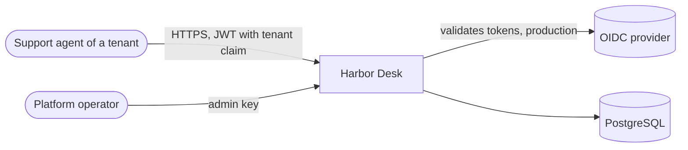
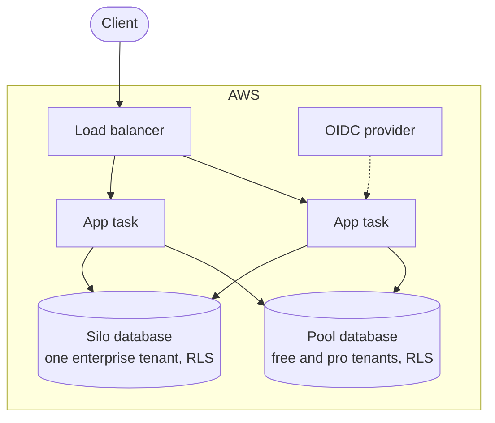
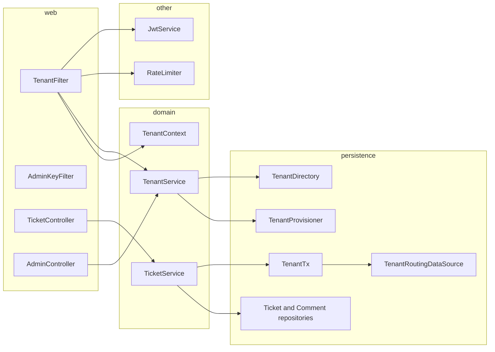
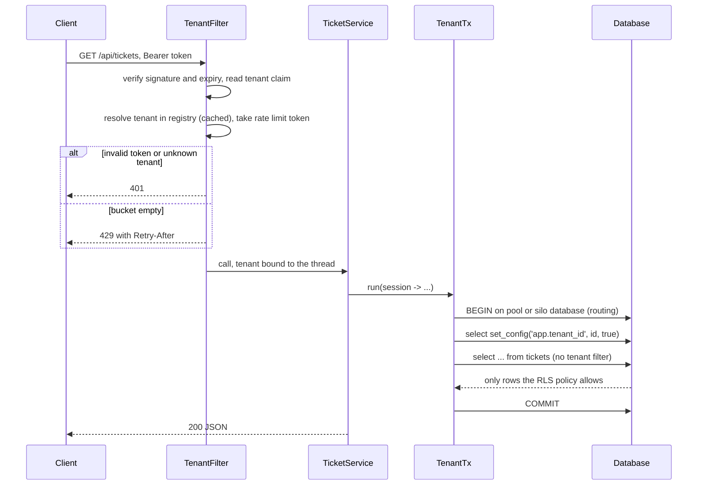

# Harbor Desk: architecture (arc42, short)

## 1. Goals

Harbor Desk is a small helpdesk (tickets and comments) sold as SaaS to many companies. The product logic is
deliberately thin. The point is multi tenancy done properly.

| Goal | What it means |
|---|---|
| Isolation | One tenant never sees or changes another tenant's data, even after a coding mistake |
| Fair use | One busy tenant cannot starve the others |
| Cost fit | Small tenants are cheap, large tenants can get their own database |
| Provable | Each claim has a test or a measurement, see `docs/proof/report.md` |

Out of scope: users and roles inside a tenant, search, attachments, e-mail, billing.

## 2. Constraints

Java 21, Spring Boot 4, PostgreSQL 16, plain SQL. Local runs and tests use a private Postgres cluster on port 55434.
Production target is AWS, described as a Terraform sketch that is validated but never applied.

## 3. Context



## 4. Building blocks

### Container view



The pool and the silo databases are on the same server in this design (same cluster locally, same RDS instance in the sketch).
The registry table that maps a tenant to its database lives in the pool database.

### Component view



Rules between the blocks are enforced by ArchUnit tests (ADR 0007): web talks to the domain only, only the persistence
package touches JDBC, every repository method needs a `TenantSession`, and only `TenantTx` creates one.

## 5. Runtime view: one request



Onboarding (`POST /admin/tenants`): check the slug, for enterprise run `CREATE DATABASE` and Flyway on it, then insert the
registry row. The app role `harbor_app` is created by the first migration, with `SELECT` on the registry and
`SELECT, INSERT, UPDATE` on tickets and comments, no `DELETE`, no DDL.

## 6. Isolation concept

- Every table has `tenant_id`. RLS is enabled and forced. Policies compare `tenant_id` with `app.tenant_id`.
- The app role has no superuser, no `BYPASSRLS`, and owns nothing. Migrations and onboarding use the owner role.
- `app.tenant_id` is set with `set_config(..., true)`, so it ends with the transaction.
- Silo databases have the same schema and the same policies.

## 7. Deployment view (AWS sketch)

```mermaid
flowchart TB
    internet((Internet)) --> alb
    subgraph vpc[VPC, two zones]
      subgraph public[Public subnets]
        alb[Application load balancer]
        nat[NAT gateway]
      end
      subgraph private[Private subnets]
        ecs[ECS Fargate service, 2 tasks]
        rds[(RDS PostgreSQL 16, Multi AZ)]
      end
    end
    alb --> ecs --> rds
    ecs --> nat
    sm[Secrets Manager] -.->|master password| ecs
    cw[CloudWatch Logs] <-. logs .- ecs
```

`infra/terraform` contains the VPC, subnets, security groups (ALB to app to database only), RDS with a managed master
password, ECS cluster, task definition, service and the load balancer. It passes `terraform fmt` and `terraform validate`.
It was never applied. The listener is plain HTTP and the NAT gateway is a single one, both fine for a sketch and
both to change before real use.

## 8. Crosscutting

- **Errors:** problem+json. Auth and rate limit errors come from the filter, the rest from a controller advice.
- **Quotas:** free 50 tickets, pro 5,000, enterprise unlimited. The create runs under an advisory lock per tenant.
- **Rate limits:** free 20 req/s, pro 100, enterprise 500 (token bucket per tenant and instance).
- **Tests:** unit tests, integration tests against real Postgres, ArchUnit rules and three proofs.

## 9. Decisions

See the list in the README. Numbers 0001 to 0007 in `docs/adr`.

## 10. Risks and open points

| Risk | Impact | Mitigation or next step |
|---|---|---|
| Rate limit is per instance | A tenant can use N times its limit on N instances | Redis based bucket, ADR 0004 |
| Silo migrations are not rolled out automatically | A silo can fall behind the pool schema | Rollout job that migrates all silos listed in the registry |
| Many silos on one server | Connection and memory pressure | Connection proxy, or silos on separate instances |
| Demo token endpoint | Anyone with the endpoint can mint tokens | Off by default, replaced by OIDC in production (ADR 0005) |
| Owner credentials sit in the app | A bug in onboarding code runs with high privileges | Move onboarding to a separate job or service with its own credentials |
| Registry cache has no invalidation | A deleted or changed tenant stays cached until restart | Short TTL or event based eviction once tenants can change |
| No cross tenant reporting | Operator cannot query usage across tenants | A separate, audited path with its own role |
